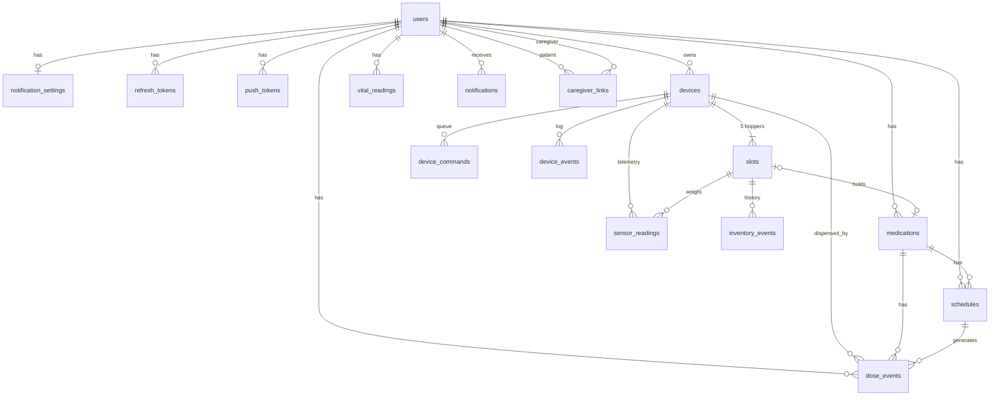

# PillPal database

PostgreSQL, managed with Prisma. The single source of truth is [`prisma/schema.prisma`](../prisma/schema.prisma);
the SQL in `prisma/migrations/` is generated from it. Browse live data with `npm run db:studio`.

## Entity-relationship diagram



## Tables

### Accounts

| Table | Purpose | Key columns |
|---|---|---|
| `users` | App accounts (patients and caregivers are the same table) | `email` (unique), `passwordHash` (bcrypt), `timezone` (IANA, drives schedule times) |
| `notification_settings` | One row per user: which alert types are on, `reminderLeadMinutes`, `requireTakenConfirmation`, quiet hours | `userId` (PK) |
| `refresh_tokens` | 30-day refresh tokens (hashed) so phones stay logged in | `tokenHash`, `expiresAt`, `revokedAt` |
| `push_tokens` | Expo push tokens of the user's phones | `token` (unique), `platform` |
| `caregiver_links` | Patient ↔ caregiver relationship + which alerts the caregiver gets | `patientId`, `caregiverId` (null until the invitee has an account), `inviteEmail`, `status`, `notifyMissedDoses`, `notifyLowStock`, `notifyDeviceIssues`, `notifyVitals` |

### Device (Raspberry Pi hub)

| Table | Purpose | Key columns |
|---|---|---|
| `devices` | One row per physical dispenser | `serialNumber` (unique), `apiKeyHash` (SHA-256 of the key the Pi uses), `claimCode` + `claimCodeExpiresAt` (shown on the touchscreen until claimed), `ownerId`, `status` (UNCLAIMED/ONLINE/OFFLINE), `lastSeenAt`, `settings` (JSON) |
| `slots` | The 5 hoppers of a device (`index` 1–5) | `medicationId` (unique – one med per slot), `pillCount`, `capacity`, `lastWeightGrams`, `lowStockNotifiedAt`, `calibration` (JSON: servo timing, tare…) |
| `device_commands` | App → Pi command queue, delivered on sync | `type`, `payload` (JSON), `status` (PENDING→SENT→COMPLETED/FAILED/EXPIRED), `result`, `expiresAt` |
| `device_events` | Log lines from the Pi (boot, jam, …) | `level`, `type`, `message`, `data`, `occurredAt` |
| `sensor_readings` | Numeric time series (load cell weight, break-beam counts, temperature…) | `type`, `value`, `unit`, `slotId`, `recordedAt` |
| `inventory_events` | Audit trail of pill counts (refill / dispense / adjustment) | `delta`, `countAfter`, `reason` |

### Medication & scheduling

| Table | Purpose | Key columns |
|---|---|---|
| `medications` | A user's medicines | `name`, `strength`, `form`, `instructions`, `pillWeightMg` (for scale-based counting), `refillThreshold` (low-stock alert level), `isActive`, `startDate`/`endDate` |
| `schedules` | Recurring rules | `timeOfDay` ("HH:MM" local), `daysOfWeek` (int[]; empty = daily), `quantity`, `graceMinutes` (missed after), `startDate`/`endDate`, `isActive` |
| `dose_events` | One row per dose occurrence – the history behind adherence stats | `scheduledAt`, `windowEndsAt`, `status`, `source`, `dispensedAt`, `takenAt`, `skippedAt`, `detectedCount`, `weightBeforeGrams`/`weightAfterGrams`, `failureReason`, `reminderSentAt`, `missedAlertSentAt`; unique on (`scheduleId`, `scheduledAt`) so generation never duplicates |

### Vitals & notifications

| Table | Purpose | Key columns |
|---|---|---|
| `vital_readings` | Blood pressure (systolic/diastolic/pulse) and single-value vitals | `type`, `source` (DEVICE/MANUAL), `value`, `unit`, `flagged`, `recordedAt` |
| `notifications` | In-app inbox + push delivery status | `type`, `title`, `body`, `data` (JSON deep-link ids), `readAt`, `pushSentAt`, `pushError` |

## Design decisions

* **Dose events are materialized.** Instead of computing "what should have happened" on the fly, the scheduler writes
  one row per occurrence 48 h ahead. That gives a simple history table, stable ids the Pi can reference, and makes
  "missed" a plain status update instead of a calculation.
* **Timezones.** Schedules store wall-clock time + the user's IANA timezone; `dose_events.scheduledAt` is the resolved
  UTC instant. Daylight-saving transitions are handled by `src/lib/time.ts` (tested).
* **Inventory lives on the slot**, not the medication: the device knows what is physically loaded; refills and dispenses
  are logged in `inventory_events`, and the Pi can correct the count from the load cell.
* **Secrets are hashed.** Passwords (bcrypt), refresh tokens and device API keys (SHA-256) are never stored in plain text.
* **Cascading deletes.** Deleting a user removes everything they own; deleting a device removes its slots, commands,
  events and readings. Dose events keep a nullable `deviceId`/`slotId` so history survives unpairing a device.
* **JSON columns** (`settings`, `calibration`, `payload`, `data`, `meta`) keep hardware-specific details flexible without
  schema changes during the capstone.

## Common queries (psql / Prisma Studio)

```sql
-- adherence last 30 days
SELECT status, COUNT(*) FROM dose_events
WHERE "userId" = '<id>' AND "scheduledAt" > now() - interval '30 days' GROUP BY status;

-- what is loaded in each slot
SELECT d.name AS device, s.index, m.name, s."pillCount" FROM slots s
JOIN devices d ON d.id = s."deviceId" LEFT JOIN medications m ON m.id = s."medicationId" ORDER BY d.name, s.index;

-- devices that have not synced in 10 minutes
SELECT name, status, "lastSeenAt" FROM devices WHERE "lastSeenAt" < now() - interval '10 minutes';
```
